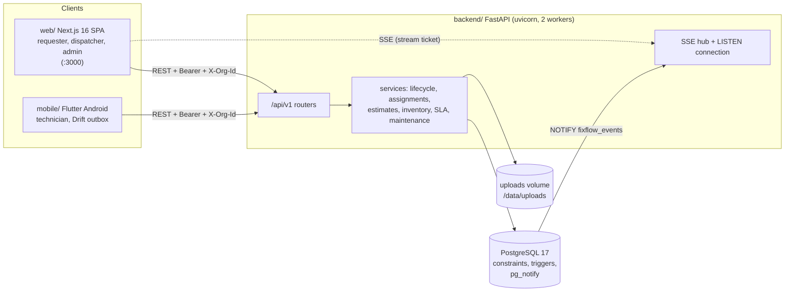

# FixFlow architecture

Covers DOC-01: component boundaries, database/storage layout, data flow for web and mobile, tenant isolation and
concurrency strategy. See also [API.md](API.md), [PRODUCT_DECISIONS.md](PRODUCT_DECISIONS.md),
[KNOWN_LIMITATIONS.md](KNOWN_LIMITATIONS.md) and [mobile/ARCHITECTURE_NOTES.md](../mobile/ARCHITECTURE_NOTES.md).

## 1. Components

| Component | Stack | Notes |
|---|---|---|
| `backend/` | Python 3.13, FastAPI, SQLAlchemy 2, Alembic, Pydantic, psycopg 3, argon2 | Routers in `app/api/v1`, business logic in `app/services`, pure SLA code in `app/sla`, CLI in `app/cli.py`. Container runs migrations, then `uvicorn --workers 2` (`backend/scripts/entrypoint.sh`). |
| `web/` | Next.js 16 (App Router, client-rendered), React 19, TypeScript strict, Tailwind 4, TanStack Query, Bun | Typed API client generated from OpenAPI (`bun run gen:api`). |
| `mobile/` | Flutter, Riverpod, Drift (SQLite), Dio | Technician app only. |
| `db` | PostgreSQL 17 | `fixflow` (app) and `fixflow_test` (tests, created by `backend/db-init`). |
| Storage | Docker named volumes `pgdata`, `uploads` | Evidence files live on the `uploads` volume; only metadata is in Postgres. |

All three share the same live records through the one REST API. Web and mobile never talk to each other or to the
database directly.

## 2. Tenancy model (PROD-03, ROLE-02..04, AUTH-03)

- A user may hold one **membership** per organization (`uq_memberships_org_user`), each with its own role
  (`REQUESTER`, `DISPATCHER`, `ADMIN`, `TECHNICIAN`). There is no platform-wide role.
- Every protected route depends on `get_ctx` (`app/core/deps.py`). It requires `Authorization: Bearer <token>` and an
  `X-Org-Id` header, then resolves session -> active user -> active membership in that org -> active organization on
  **every request**. Result is an immutable `Ctx(user_id, org_id, membership_id, role, timezone)`.
  - Missing or malformed `X-Org-Id`: `400 org_required`.
  - Org the user is not an active member of (or inactive org/membership): `403 org_access_denied`.
- Role checks use `require_roles(...)` in the backend; UI hiding is presentation only.
- **404 vs 403.** Fetching a resource by id always goes through org-scoped queries (`scoped`, `get_or_404` in
  `app/core/tenancy.py`). A row that belongs to another organization is indistinguishable from a missing one: `404`.
  `403` is used only for "you are a member but your role may not do this" and for an org you do not belong to.
  Requester-only visibility (own requests, granted properties) also answers `404`/filters rather than leaking existence.
- **Database backstop.** Every tenant-owned table has `organization_id`, plus `UNIQUE (organization_id, id)` so child
  tables can use **composite foreign keys** `(organization_id, parent_id) -> parent(organization_id, id)`. A row in
  org A therefore cannot reference a row in org B even if application code were wrong (DATA-02).
- Web switches organization explicitly (`/select-org`) and clears the query cache; mobile pins one org per session.

## 3. Authentication (AUTH-01..05, SEC-03)

- `POST /auth/login` verifies the password with **argon2id** (`argon2-cffi` defaults) and spends comparable time on
  unknown emails (`DUMMY_HASH`).
- Session tokens are **opaque** random values (`secrets.token_urlsafe(32)`); only the **SHA-256 hash** is stored
  (`sessions.token_hash`, unique). Sessions expire (`SESSION_TTL_MINUTES`, default 720) and can be revoked (logout,
  deactivation). Expired -> `401 session_expired`; revoked/unknown -> `401`.
- **Rate limiting is DB-based** so it is shared by all workers: failed logins are counted in `security_events` over a
  15-minute window, 10 per email hash and 30 per client IP; beyond that `429 too_many_requests`. Emails are stored hashed
  in security events; passwords and tokens are never logged.
- CORS allows only configured origins (`CORS_ORIGINS`), no wildcard, no cookies (so no CSRF surface).

## 4. Request lifecycle engine (LIFE-01..09)

`app/services/lifecycle.py` holds one table, `TRANSITIONS: {(from, to): rules}`, and one `transition()` function.
Each rule names the allowed actor roles/ownership and extra guards (reason length, completion note >= 20 chars plus a
completion image, estimate gate, material validation). `transition()`:

1. locks the request row (`SELECT ... FOR UPDATE`),
2. validates the pair, actor and guards (invalid -> `409`/`422` with a clear code),
3. applies side effects (timestamps, assignment release, SLA events, notifications),
4. writes `request_events` and `audit_events` **in the same transaction**.

Endpoints such as `/triage`, `/accept`, `/complete` are thin wrappers. `GET /requests/{id}` returns `allowed_actions`
computed from the *same* table, so web and mobile show or hide buttons from server truth rather than duplicated rules.

## 5. Guarantees enforced by the database (DATA-05, SCHED-04, INV-04, API-03..05)

| Guarantee | Mechanism | Client-visible result |
|---|---|---|
| A technician cannot hold two overlapping active assignments | `assignments`: `EXCLUDE USING gist (technician_membership_id WITH =, tstzrange(start_at, end_at, '[)') WITH &&) WHERE (active)` (needs `btree_gist`); `[)` ranges so adjacent slots are fine | Losing writer gets `409 schedule_conflict` |
| One active assignment per request | partial unique index `uq_assignments_one_active_per_request` | 409 |
| Assignment history is never deleted | `trg_assignments_no_delete`; decline/unassign sets `active=false` + `released_reason` | history preserved |
| Stock never negative, no double consumption | conditional `UPDATE ... SET stock = stock - q WHERE stock >= q` (rowcount checked) + `CHECK stock_quantity >= 0` + `stock_movements` ledger | `409 insufficient_stock`, no usage row |
| Replay-safe material usage | `UNIQUE (organization_id, client_command_id)` on `material_usage`; unit cost snapshotted | replay returns original result (200) |
| Retry-safe commands (assign, estimate, generate, stock) | `idempotency_keys` table: `Idempotency-Key` + payload hash; same key and payload replays the stored response | different payload -> `409 idempotency_key_reused` |
| Replay-safe notes/uploads | unique `client_command_id` (and `client_index` for files) per org | exactly one note/file per intended item |
| Estimate immutability | trigger `estimates_guard_immutable` rejects changes to totals/lines after submit; new version row linked by `supersedes_id`; `UNIQUE (request_id, version)` | edits after submit need a new version |
| Two simultaneous estimate decisions | decision is a conditional `UPDATE ... WHERE status='AWAITING_APPROVAL' AND version=?`, rowcount must be 1 | loser gets `409` |
| Append-only history | `forbid_mutation()` triggers on `request_events`, `work_notes`, `stock_movements`, `material_usage`, `feedback`; `audit_events_immutable()` trigger on `audit_events` | UPDATE/DELETE raises |
| Maintenance generated once per occurrence | `UNIQUE (plan_id, occurrence_date)` on `service_requests` + `INSERT ... ON CONFLICT DO NOTHING` | two simultaneous runs create one request |
| Escalation notified once | `overdue_notified_at IS NULL` selected `FOR UPDATE SKIP LOCKED`, plus unique `(org, recipient, dedupe_key)` on notifications | one notification |
| Money is exact | integer tyiyn columns, half-up integer rounding, `currency = 'KGS'` CHECK | no floats |
| Valid data | `CHECK`s (30-minute minimum appointment, positive quantities, non-negative amounts, rating 1-5) | 422/409 |

Because correctness lives in Postgres, the API runs with two uvicorn workers (SEC-07) and `scripts/simulate_race.py`
proves the races (`assignment`, `inventory`, `replay`) against a running stack.

## 6. SLA engine and escalation (SLA-01..07)

- `app/sla/calendar.py`: pure business-time arithmetic (`add_business_minutes`, `business_minutes_between`) over the
  organization's weekly hours, holidays and IANA timezone (default `Asia/Bishkek`, Mon-Fri 09:00-18:00).
- `app/sla/engine.py`: derives the SLA state **only from `request_events`** (`REQUEST_CREATED`, estimate
  submitted/approved/rejected/withdrawn, `PRIORITY_CHANGED`, status changes). Budgets are HIGH 8 h, NORMAL 24 h, LOW 48 h
  of business time. The clock pauses while an estimate awaits approval. A priority change replaces the budget
  (remaining = new budget - consumed). ON_TRACK / AT_RISK (<= 25% left) / OVERDUE (< 0 left); outcome is frozen at
  completion/cancel. A reopened request restarts the clock with consumed time carried over (documented decision).
- `service_requests.sla_due_at` is a cache (NULL while paused) used for list filter/sort; `python -m app.cli
  sla-recompute` re-derives it.
- Escalation: `python -m app.cli sla-escalate` (also `POST /admin/sla/escalate`) notifies dispatchers/admins once per
  newly overdue request; repeated runs create no duplicates.
- Maintenance generation: `python -m app.cli generate-maintenance --as-of YYYY-MM-DD` (also `POST
  /maintenance-plans/generate`). Monthly recurrence clamps to month end.

## 7. Live updates over SSE (API-06, WEB-08)

1. Writers call `core.events.publish` inside their DB transaction, which issues `pg_notify('fixflow_events', ...)`; a
   NOTIFY exists only if the transaction commits.
2. Each API worker keeps one `LISTEN fixflow_events` connection (started in the app lifespan, reconnect with backoff)
   and fans events out to in-process subscribers. Postgres is the only cross-worker channel.
3. A client calls `POST /stream/ticket` (Bearer + `X-Org-Id`) to get a 60 s opaque ticket, then opens
   `GET /stream?ticket=...` (browsers' `EventSource` cannot send headers). Events carry only
   `kind`, `request_id`, `notification_id`, `at` and are filtered per membership/role. Session/membership are
   re-validated periodically; the server sends `ping`, `resync` after a listener reconnect, and `closed`.
4. Events are hints: the web client invalidates TanStack Query caches and **re-fetches canonical state** on every
   (re)connect and on `resync`.

## 8. Files

Upload (`POST /requests/{id}/files`): JPEG/PNG/WebP only, <= 10 MiB, content sniffed and pixel size checked, stored
under a server-generated path on the `uploads` volume; the failed-upload path leaves no accessible record. Download
(`GET /files/{id}`) requires Bearer + `X-Org-Id` and an authorization check, served with `nosniff` and
`Cache-Control: private, no-store`. The web client fetches files as authenticated blobs.

## 9. Web structure (`web/src`)

- `app/(public)` login and organization selection; `app/(app)` authenticated layout with role-based navigation
  (`lib/nav.ts`) and routes: `dashboard`, `queue`, `requests`, `jobs`, `schedule`, `properties`, `assets`, `estimates`,
  `notifications`, `overdue`, `admin`.
- `features/*` per role/area (`requester`, `dispatch` incl. Smart Assign, `request-detail`, `request-actions`, `admin`,
  `dashboard`, `auth`). `request-actions` is a registry that maps server `allowed_actions` to UI.
- `lib/api` (typed `openapi-fetch` client), `lib/auth` (session in `sessionStorage`, per tab), `lib/live` (SSE),
  `lib/query` (cache; cleared on org switch).
- Tests: Vitest + MSW under Bun (`bun run test:ci`).

## 10. Mobile offline outbox (MOB-04..08)

Summary (details in [mobile/ARCHITECTURE_NOTES.md](../mobile/ARCHITECTURE_NOTES.md) and
[mobile/README.md](../mobile/README.md)):

- Drift/SQLite caches the last synced assigned jobs (`cached_jobs`) so job detail works offline and survives process
  death.
- Offline, a technician can only create **work notes and attach images** to cached jobs. Each becomes a row in
  `pending_commands` (+ `pending_attachments`) with a client-generated `client_command_id` (UUID) and status
  `PENDING/SYNCING/CONFLICT/FAILED`; the UI shows "Pending sync", queued time and retry/discard.
- On reconnect the outbox replays per job in order: attachments first (keyed by command id + index), then the note
  with the same `client_command_id`. 2xx or replay-200 removes the command; network/5xx retries with backoff;
  403/404/409 (reassigned, closed, lost access) moves it to `CONFLICT` and keeps the draft until the user decides.
- Server-side the `client_command_id` unique constraints make duplicate delivery produce exactly one note and one file.
- Accept/start/block/complete, estimate-dependent start and material consumption are online-only and visibly disabled
  offline with an explanation.
